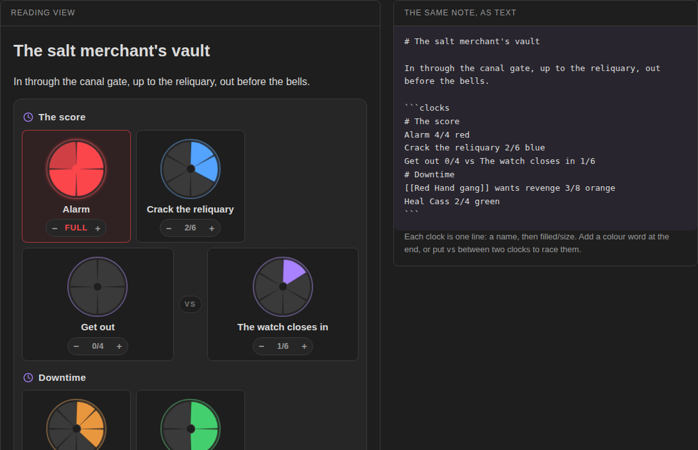

# Tabletop Clocks

Segmented progress clocks for tabletop games, drawn from plain text in your note. Track the alarm, the plan, the faction that wants you dead. Click a segment to tick it, race two clocks against each other, and the note keeps the count.



**Try it in your browser** before installing: https://bulkhead.bananafest-destiny.com/press/tabletop-clocks/ runs the real plugin code over a sample note and shows the note's text changing as you click.

## Write a clock

Write a `clocks` block, one clock per line:

````
```clocks
# The score
Alarm 1/4 red
Crack the vault 2/6
Get out 0/4 vs The watch closes in 1/6
# Factions
[[Red Hand gang]] wants revenge 3/8 orange
```
````

Switch to reading view (or live preview) and each line becomes a clock.

| Write | Meaning |
| --- | --- |
| `Alarm 1/4` | a clock named Alarm, 1 of 4 segments filled |
| `Alarm` | a new clock with the default size from settings |
| `red`, `orange`, `yellow`, `green`, `cyan`, `blue`, `purple`, `pink` at the end | the clock's colour |
| `Get out 0/4 vs The watch 1/6` | a racing pair, side by side; when one fills, the other fades |
| `# Factions` | a heading that starts a new group |
| `[[Note]]` in the name | click the name to open that note |

Clocks run from 2 to 12 segments.

The command **Insert clocks** drops a starter block at the cursor.

## At the table

| Do | How |
| --- | --- |
| Fill up to a segment | click it |
| Clear the last segment | click it again, or press − |
| Tick one segment | press + |
| Use the keyboard | click a clock (or tab to it) and use the arrow keys |
| Add a clock | type in the box under the clocks: `Rumours`, `Ritual 0/8 purple`, or a racing pair |

A full clock glows and shows **Full**, and a short notice says so (you can turn that off).

Every change is written back into the line, so the note always reads fine as text, syncs like any note, and still makes sense if you ever uninstall the plugin.

## For other plugins

Each change fires a workspace event:

```ts
this.registerEvent(
	this.app.workspace.on('tabletop-clocks:change', (e) => console.log(e.name, e.filled, e.size, e.full)),
);
```

The event carries `sourcePath`, `name`, `link`, `filled`, `previous`, `size` and `full`.

## Credit

Progress clocks come from John Harper's *Blades in the Dark*. This plugin is not made by or affiliated with its publisher; it just draws the clocks.

## Privacy

Tabletop Clocks does not use the network, has no accounts, collects nothing and sends nothing. It only edits the `clocks` block it is drawing.

## Install

From Obsidian: Settings → Community plugins → Browse → search "Tabletop Clocks".

By hand: copy `main.js`, `manifest.json` and `styles.css` from the latest release into `<your vault>/.obsidian/plugins/tabletop-clocks/`, then enable it under Community plugins.

## Also from this maker

- [Dice Tray](https://github.com/walkertbrown/dice-tray): rolls dice, random tables and note sections inline, and reads Dice Roller's `dice:` syntax.
- [Quick Initiative](https://github.com/walkertbrown/quick-initiative): a light initiative tracker that lives as plain text in your note.
- [Session Log](https://github.com/walkertbrown/session-log): a quick log for game night. With Quick Initiative installed, fights log themselves.
- [Encounter Builder](https://github.com/walkertbrown/encounter-builder): plan fights against the 5E XP budget, then start them in Quick Initiative.

## Source

https://github.com/walkertbrown/tabletop-clocks

## Build

```
npm install
npm test
npm run build
```

MIT licensed.
